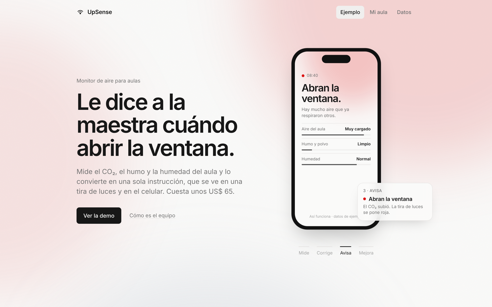
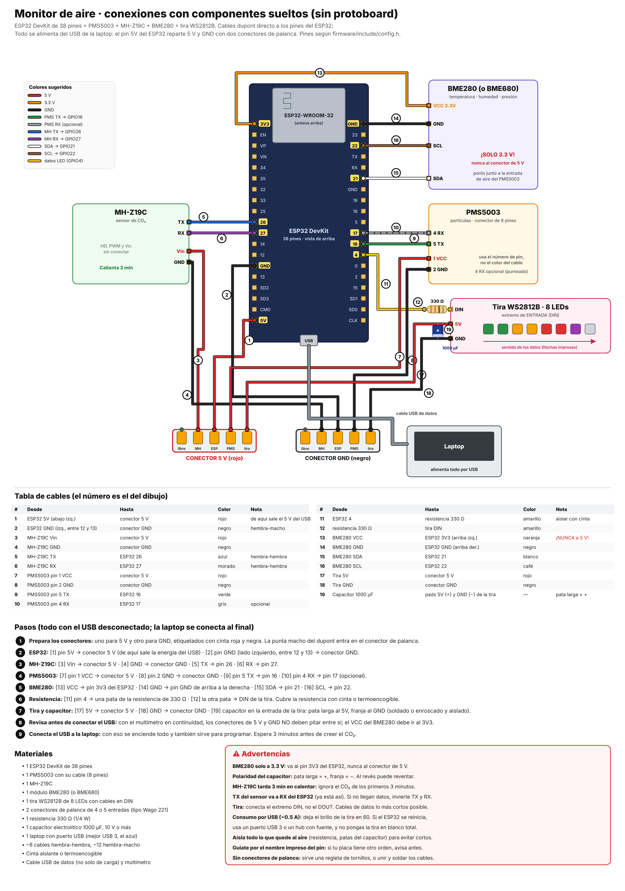

# UpSense

**Precisión de 600 dólares, por 65.** Un sensor barato que piensa como uno caro: le dice a la maestra cuándo abrir o cerrar la ventana del aula.

Un monitor de aire de unos US$ 65 que mide el CO₂, las partículas y la humedad del aula, y lo traduce en una sola instrucción: *abran la ventana*, *ábranla un poco*, *ciérrenla* o *abran cinco minutos y cierren*. La respuesta se ve en una tira de luces desde el fondo del salón y en una página web.

**App web (funciona sin el equipo, con datos de ejemplo):** https://ventana-aula.vercel.app

**Video de la demo:** https://youtube.com/shorts/rBpN5EhJVPQ



## El problema

En Guatemala muchas escuelas están junto a calles con tráfico y quemas. La maestra tiene que elegir entre dos riesgos: con la ventana cerrada se acumula el aire que ya respiraron los niños, y con ella abierta entra humo. Los sensores de partículas baratos ayudan, pero tienen una falla: **confunden las gotitas de agua con humo**. En una mañana con lluvia o niebla dan falsas alarmas y mandan a cerrar justo cuando hay que ventilar.

## La idea, desde la ciencia

UpSense toma dos hallazgos recientes y los vuelve un aparato que una maestra puede usar sin saber nada técnico.

| Hallazgo | Qué tomamos |
|---|---|
| **Sitarek, Emerling y Schmidt (2026).** *Sensors* 26(21):6718. [doi:10.3390/s26216718](https://doi.org/10.3390/s26216718) | El error que la humedad mete en los sensores ópticos baratos se puede corregir por software con temperatura, humedad y presión, usando modelos livianos que caben en un microcontrolador. |
| **Vouriot et al. (2024).** *Journal of the Royal Society Interface*. [doi:10.1098/rsif.2024.0270](https://doi.org/10.1098/rsif.2024.0270) | Con un sensor de CO₂ se estima qué fracción del aire ya fue respirada por otros y, con ella, el riesgo relativo de contagio por aire. |

En una mañana simulada con niebla, el sensor sin corregir dio **173 minutos de falsa alarma**; UpSense, **12**.

> **Importante:** el modelo de corrección está entrenado con datos **sintéticos**. Falta validarlo con una medición real junto a una estación de referencia. El protocolo está en [calibracion/docs/protocolo_datos_reales.md](calibracion/docs/protocolo_datos_reales.md).

## Cómo funciona

1. **Mide.** Un MH-Z19C (CO₂), un PMS5003 (partículas) y un BME280 (temperatura, humedad y presión), conectados a un ESP32.
2. **Corrige y decide.** El ESP32 corrige las partículas por humedad. Si la humedad pasa de 95 % o sube de golpe (vapor, trapear, lluvia), deja en pausa la lectura de partículas y decide solo por CO₂. Después elige una instrucción. Todo pasa dentro del equipo, sin internet.
3. **Avisa.** Una tira de 8 LEDs cambia de color, y la página web muestra lo mismo con detalle.

| Luz | Instrucción |
|---|---|
| Verde | Todo bien |
| Ámbar (media tira) | Abran un poco la ventana |
| Rojo | Abran la ventana |
| Morado | Cierren la ventana (entra humo) |
| Naranja parpadeando | Abran cinco minutos y cierren |

## En qué se diferencia

Ya existen monitores que dicen cuándo ventilar, como IQAir AirVisual Pro o Airthings View Plus, pero cuestan entre US$ 330 y 600 por aula. Los programas escolares grandes (Inglaterra, Baviera, Madrid) solo miden CO₂. AirGradient, el más parecido y también abierto, ya corrige la humedad, pero muestra colores, no una instrucción.

UpSense busca darle a una escuela pública lo mismo por unos US$ 65: una sola orden en español para la maestra, una luz que ve toda la clase y una corrección por humedad que se puede ajustar con mediciones de Guatemala.

Ojo: UpSense tiene un solo sensor de partículas, dentro del aula. No mide el aire de afuera; deduce que entra humo cuando las partículas suben y la humedad no explica la subida.

## Qué hay en este repositorio

```
dashboard/     App web estática (HTML, CSS y JS sin librerías). La sirve el ESP32 o cualquier hosting.
firmware/      Código del ESP32 (PlatformIO, Arduino).
  include/config.h   ← aquí van tu red WiFi y los pines
sim/           Simulador del equipo en Python: prueba la app sin hardware.
calibracion/   Núcleo científico: modelo de corrección, entrenamiento, pruebas de paridad Python = JS = C.
docs/          Guía de armado, diagramas de conexiones y capturas.
```

## Probarlo sin hardware

Abre https://ventana-aula.vercel.app, o en tu compu:

```bash
python3 sim/simulador.py --rapido     # abre http://localhost:8000 (1 s real = 1 min simulado)
python3 sim/simulador.py --escenario humo
```

## Armarlo

**Piezas:** ESP32 DevKit de 38 pines, PMS5003, MH-Z19C, BME280, tira WS2812B de 8 LEDs, resistencia de 330 Ω, capacitor de 1000 µF, dos conectores de palanca (tipo Wago), cables dupont y un cable USB de datos.

Todo se alimenta por el USB del ESP32. La guía paso a paso, con la tabla de cables y las advertencias, está en [docs/armado-sueltos.md](docs/armado-sueltos.md).



| Sensor | Pin del sensor | ESP32 |
|---|---|---|
| PMS5003 | VCC / GND / TX / RX | 5V / GND / GPIO16 / GPIO17 (opcional) |
| MH-Z19C | Vin / GND / TX / RX | 5V / GND / GPIO26 / GPIO27 |
| BME280 | VCC / GND / SDA / SCL | **3V3** / GND / GPIO21 / GPIO22 |
| Tira WS2812B | DIN / 5V / GND | GPIO4 con 330 Ω / 5V / GND, con 1000 µF entre 5V y GND |

El BME280 va **solo a 3.3 V** y junto a la entrada de aire del PMS5003, lejos del calor del ESP32.

## Flashear el ESP32

Necesitas [PlatformIO](https://platformio.org/).

```bash
cd firmware
# 1) En include/config.h cambia WIFI_SSID y WIFI_PASSWORD por los de tu red
pio run -t upload       # sube el firmware
pio run -t uploadfs     # sube la app web (../dashboard) a la memoria del ESP32
pio device monitor      # muestra la IP y las lecturas
```

No subas tu clave de WiFi real a GitHub: el repositorio trae `TU_RED` / `TU_CLAVE` de ejemplo.

## Usarlo

- **Con WiFi:** abre `http://aire.local` o la IP que muestra el monitor serie.
- **Sin WiFi:** el equipo crea su propia red, **MonitorAire** (clave `aire1234`). Conéctate y abre `http://192.168.4.1`.
- El MH-Z19C tarda unos 3 minutos en calentarse.
- En la app, **Proyectar en pantalla completa** deja solo la instrucción, para ponerla en el proyector del aula.
- **Datos** permite cargar un CSV (por ejemplo, una medición junto a una estación de referencia) y ver qué habría recomendado UpSense.

## Estado del proyecto

Prototipo hecho para el Hackathon Open2 (track DeepTech «Del paper al producto»), Guatemala, noviembre de 2026.

- La app web funciona y está publicada.
- El firmware **todavía no se ha compilado ni probado en el equipo**. Los lectores de sensores y la lógica del semáforo sí tienen pruebas en la PC (`firmware/test/host/correr.sh`).
- El modelo de corrección está entrenado con datos sintéticos.

Primer usuario: una maestra de 3.º a 6.º primaria en un colegio pequeño junto a una vía transitada de la Ciudad de Guatemala.

## Licencia

[MIT](LICENSE): puedes usar, copiar y modificar el código libremente, siempre que mantengas el aviso de licencia.

> **Sobre los nombres internos:** el proyecto empezó llamándose «Ventana». Algunos archivos y funciones internas conservan ese nombre (`ventana_calib.h`, `ventana-calib.js`, `ventana_calibrar()`) para no romper las pruebas de paridad entre Python, JavaScript y C.
